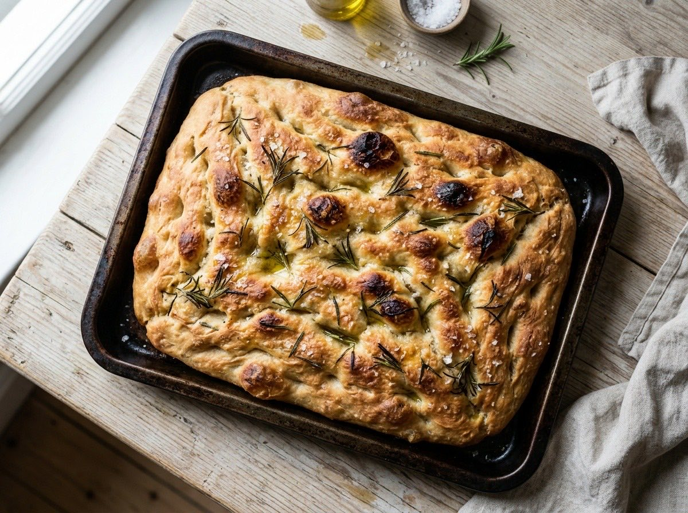

# Sourdough focaccia

{.medium}

| Ingredient   | Grams |
| ------------ | ----: |
| Bread flour  |   500 |
| Water        |   400 |
| Starter      |   100 |
| Salt         |    12 |
| Olive oil    |    40 |
| **Dough**    | [?](#SUM(B1:B5)) |
| Hydration %  | [?](#ROUND(B2/B1*100,0)) |

1. Mix flour and water; rest 1 hour.
2. Add starter and salt, fold every 30 minutes for 2 hours.
3. Cold proof overnight, dimple with oil, bake at 230 °C for 25 minutes.

> Fold gently: the bubbles are the whole point.
